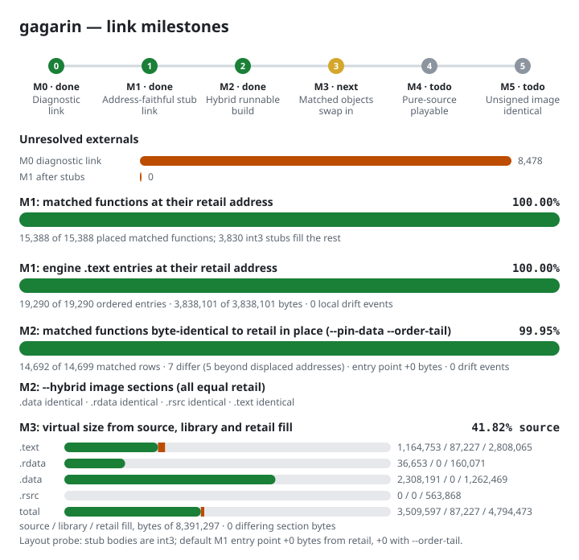

# gagarin

**gagarin** is reconstructing the *Command & Conquer: Red Alert 2 — Yuri's
Revenge* engine from retail `gamemd.exe` v1.001. The aim is a buildable,
structured, human-readable C++ project whose classes and organization follow
Westwood's as closely as binary evidence allows. Each annotated engine function
aims to reproduce the retail instructions with the period compiler, including
verified layouts and address bindings. Statically linked library code is outside
source-recovery scope. Function matching and successful compilation do not prove
whole-image identity.

The current project status, verified progress, consolidation record, coverage
caveats and remaining gates are in [STATUS.md](STATUS.md). The target image is
identified by SHA-256 in [reccmp-project.yml](reccmp-project.yml).

As of 2026-10-23, 10,204 of the 19,778 functions in the extent census are
matched (51.6%) and 686 more are partial; matched bodies cover 704,282 of
3,878,653 listed function bytes (18.2%). Raw and strict relocation checks
pass on every matched row. At the historical link snapshot `2a00ae5d`, the
address-faithful stub link (M1) resolved every external and placed 10,174 matched functions at their retail
addresses; the remaining matched row shares its symbol with another address. The engine does not yet run from this build, and no whole-image
identity is claimed.




## Get started

You need a legally owned copy of `gamemd.exe` v1.001 for retail verification,
Wine (WoW64), Python 3, Git, 7-Zip, GNU `objdump`, Ghidra, and the MSVC 6.0
toolchain fetched separately by `scripts/vc6/fetch_toolchain.sh`. Do not commit
the game binary, assets, PDBs, build outputs or toolchain.

```bash
scripts/vc6/fetch_toolchain.sh
scripts/vc6/compile_all.sh
GAMEMD_BINARY="/path/to/gamemd.exe" python3 scripts/vc6/verify_all.py
python3 scripts/vc6/build_project.py --jobs 8
python3 scripts/vc6/link_diag.py --objdir build-vc6/project
python3 scripts/vc6/link_m1.py --objdir build-vc6/project
```

`compile_all.sh` is the binary-free compile gate. `verify_all.py` checks the
manifest's fully matched functions against the pinned retail binary and
compile-checks documented partial rows. `build_project.py` compiles tracked
C++ files into path-preserving VC6 objects. Two link probes run on those
objects: `link_diag.py` (M0) links everything with `/FORCE` and counts the
unresolved externals, and `link_m1.py` (M1) links the objects with int3 stubs
in retail order, then `mapcheck.py` checks each matched function's linked
address. Neither image runs. `scripts/orchestration/link_svg.py --refresh`
updates the link figures from their output. See
[CONTRIBUTING.md](CONTRIBUTING.md)
for setup, the per-function matching workflow and file conventions; [AGENTS.md](AGENTS.md)
defines the evidence and engineering rules; [LEGAL.md](LEGAL.md) defines the
legal scope and provenance restrictions.

## Evidence and legal scope

The retail binary is the authority for addresses, layouts, signatures and
matches. External references can suggest names or organization, but every fact
must be confirmed against binary evidence. Source recovery for statically linked
CRT and third-party code is out of scope; their bytes still belong to the
complete executable reproduction target.

See [LEGAL.md](LEGAL.md) for licensing, permitted source material and commit
restrictions, and [LICENSE](LICENSE) for the licence text.

## Credits

- [itsmattkc/MSVC600](https://github.com/itsmattkc/MSVC600) supplies the fetched
  VC6 toolchain.
- [reccmp](https://github.com/isledecomp/reccmp) provides the annotation format
  and project configuration; this repository implements the byte and
  instruction checks.
- [decomp-permuter](https://github.com/simonlindholm/decomp-permuter) supports
  bounded source-variation searches.
- [REA](https://github.com/morluto/rea) and Ghidra support focused reverse
  engineering and evidence gathering. Retail instructions and the VC6 oracle
  remain the factual checks.
- YRpp, TSpp and EA's released Red Alert source are consult-only naming and
  structure references, as restricted by [LEGAL.md](LEGAL.md).
