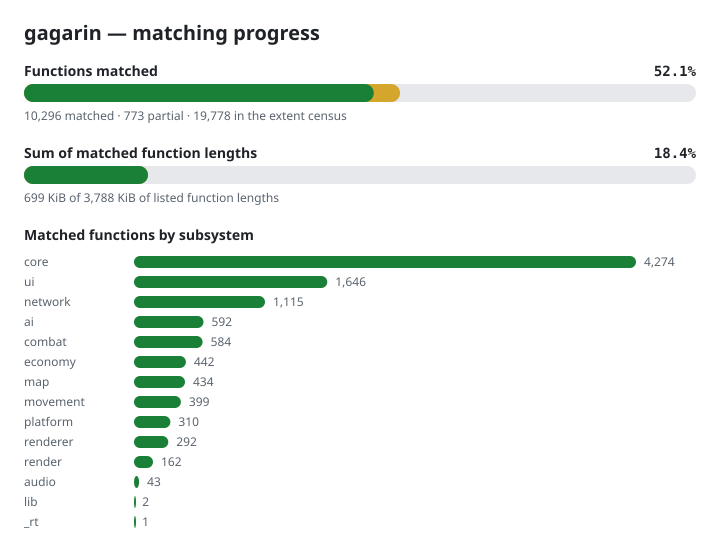

# gagarin

**gagarin** is reconstructing the *Command & Conquer: Red Alert 2 — Yuri's
Revenge* engine from retail `gamemd.exe` v1.001. The aim is a buildable,
structured, human-readable C++ project whose classes and organization follow
Westwood's as closely as binary evidence allows. The ultimate goal is an
integrated build that reproduces the complete pinned executable byte for byte.
That goal has not been achieved; function-level matching and successful
compilation do not prove whole-image identity.

The current project status, verified progress, consolidation record, coverage
caveats and remaining gates are in [STATUS.md](STATUS.md). The target image is
identified by SHA-256 in [reccmp-project.yml](reccmp-project.yml).
The latest full gates pass with 3,579 functions matched at 100%, 165 partial
rows, and 876 tracked C++ files. The complete executable build and byte-for-byte
comparison remain unfinished.



## Get started

You need a legally owned copy of `gamemd.exe` v1.001 for retail verification,
Wine (WoW64), Python 3, Git, 7-Zip, GNU `objdump`, Ghidra, and the MSVC 6.0
toolchain fetched separately by `scripts/vc6/fetch_toolchain.sh`. Do not commit
the game binary, assets, PDBs, build outputs or toolchain.

```bash
scripts/vc6/fetch_toolchain.sh
scripts/vc6/compile_all.sh
python3 scripts/vc6/verify_all.py
```

`compile_all.sh` is the binary-free compile gate. `verify_all.py` checks the
manifest's fully matched functions against the pinned retail binary and
compile-checks documented partial rows. See [CONTRIBUTING.md](CONTRIBUTING.md)
for setup, the per-function matching workflow and file conventions; [AGENTS.md](AGENTS.md)
defines the evidence and engineering rules; [LEGAL.md](LEGAL.md) defines the
legal scope and provenance restrictions.

## Evidence and legal scope

The retail binary is the authority for addresses, layouts, signatures and
matches. External references can suggest names or organization, but every fact
must be confirmed against binary evidence. Source recovery for statically linked
CRT and third-party code is out of scope; their bytes still belong to the
complete executable reproduction target.

See [LEGAL.md](LEGAL.md) for licensing, permitted source material and commit
restrictions, and [LICENSE](LICENSE) for the licence text.

## Credits

- [itsmattkc/MSVC600](https://github.com/itsmattkc/MSVC600) supplies the fetched
  VC6 toolchain.
- [reccmp](https://github.com/isledecomp/reccmp) provides the annotation format
  and project configuration; this repository implements the byte and
  instruction checks.
- [decomp-permuter](https://github.com/simonlindholm/decomp-permuter) supports
  bounded source-variation searches.
- [REA](https://github.com/morluto/rea) and Ghidra support focused reverse
  engineering and evidence gathering. Retail instructions and the VC6 oracle
  remain the factual checks.
- YRpp, TSpp and EA's released Red Alert source are consult-only naming and
  structure references, as restricted by [LEGAL.md](LEGAL.md).
